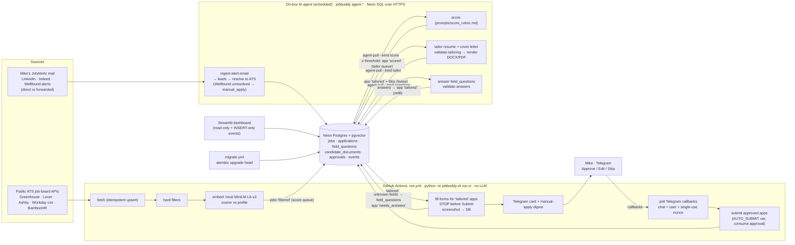

# jobbuddy

Human-in-the-loop job-application automation for **Michael A. Valdés** (Product Solution Architect, San Francisco).

The work is split between two halves:

* **CI (GitHub Actions)** does the mechanical work and calls no LLM. It fetches public ATS job boards,
  applies hard filters, embeds jobs with a local MiniLM model, fills application forms with Playwright, and
  **stops before the final Submit**. It then sends a screenshot to Telegram with Approve/Edit/Skip buttons,
  polls the callbacks, and submits only applications Mike has approved.
* **The on-box AI agent** (an AI assistant on Mike's machine, run on a schedule) does the judgement work:
  it reads job-alert e-mails, scores jobs, tailors the resume (reorder/reword only, validated), writes the
  cover letter in Mike's voice, and answers form questions CI couldn't fill. It talks to Neon **over HTTPS**
  (SQL-over-HTTP) because that machine can't reach port 5432.

The two halves never call each other. They meet only through **work queues in the database**. Nothing is
submitted without a single-use approval row, and `AUTO_SUBMIT` defaults to `false`.

> Read [SAFETY.md](SAFETY.md) before running anything. [FORM_HANDLING.md](FORM_HANDLING.md) explains how
> forms are inspected, mapped and scored. [jobbuddy/prompts/](jobbuddy/prompts/README.md) holds the agent's
> instructions.

## Architecture



## Queue contract (database state machine)

| Queue | Rows waiting | Worked by | Result |
|---|---|---|---|
| score | `jobs.status = 'filtered'` (CI hard-filtered and embedded them, similarity ≥ threshold) | agent: `agent-pull --kind score` → `agent-push-scores` | `job_scores.llm_score`. At or above `matching.agent_score_threshold` (70) the job becomes `scored` and an application is created with status `scored`; below it the job becomes `below_threshold` |
| tailor | `applications.status = 'scored'` | agent: `agent-pull --kind tailor` → `validate-tailoring` → `agent-push-tailoring` | resume JSON, cover letter text, answers; DOCX/PDF files in `candidate_documents` (linked by `application_id`); status → `tailored` |
| fill | `applications.status = 'tailored'` | CI `run-ci` | stops before Submit → `awaiting_approval` (screenshot in DB, Telegram card). Fields it can't fill → `field_questions` rows (`pending`) and status → `needs_answers` |
| questions | `field_questions.status = 'pending'` (application in `needs_answers`) | agent: `agent-pull --kind questions` → `validate-answers` → `agent-push-answers` | answered/dismissed. When none are pending, the app → `tailored` and the next CI run refills |
| approval | `applications.status = 'awaiting_approval'` | Mike (Telegram buttons, dashboard, or `jobbuddy approve`) | `approvals` row (single-use nonce) → `approved`, or an edit → `tailored` (refill), or `skipped` |
| submit | `applications.status = 'approved'` | CI (only if `AUTO_SUBMIT=true`) or `jobbuddy submit --confirm` | consumes the approval atomically → `submitted` |
| manual apply | `jobs.status = 'manual_apply'` (Wellfound leads with no public ATS match) | CI sends one Telegram digest per lead; Mike applies by hand | — |

```
jobs:          found → filtered ─(agent score)→ scored | below_threshold        (filtered_out, closed, manual_apply)
applications:  scored ─(agent tailor)→ tailored ─(CI fill)→ filled → awaiting_approval ─(Mike)→ approved → submitted
                                          ↑   └→ needs_answers ─(agent answers)┘
                                          └──── edit from Telegram/dashboard ────┘        (paused / failed / skipped)
```

Every agent push is guarded by the expected current status and executed as one batch transaction. A stale
or replayed push is a no-op.

## Repository layout

```
jobbuddy/
  cli.py                 Typer CLI (run-ci, agent-*, validate-*, ingest-alert-email, fill, approve, submit, ...)
  pipeline.py            CI stages + run_ci (one DB session per run, no LLM)
  agent_io.py            on-box agent queues: pull / validate / push / ingest (raw DML through a SqlTransport)
  prompts/               score_rubric.md, tailor_resume.md, cover_letter.md (voice sample injected), answer_questions.md
  config.py              env settings (pydantic-settings) + config/config.yaml
  profile.py             profile loader (CANDIDATE_PROFILE_JSON or profile/profile.yaml), TODO detection
  logging_utils.py       PII-redacting log filter
  embeddings.py          sentence-transformers all-MiniLM-L6-v2 (384-d), hashing fallback for tests
  vector_store.py        pgvector / Azure SQL VECTOR_DISTANCE / Python cosine backends
  llm/client.py          model-call protocol + strict JSON helpers only (no network client)
  db/                    models, session, states, repository, transport.py (SQLAlchemy | Neon HTTP), neon_http.py
  fetchers/              greenhouse, lever, ashby, workday, bamboohr, email_alerts (LinkedIn/Indeed/Wellfound), registry
  matching/              filters, similarity
  tailoring/             validator (fabrication checks), resume, render (DOCX/PDF), cover_letter, questions, style
  engine/                form_inspector, field_mapper, filler, detectors, human, browser, submitter, adapters/
  notifiers/             telegram (primary), slack, email
dashboard/app.py         Streamlit (light requirements in dashboard/requirements.txt)
migrations/              Alembic (0001 = vector extension + full schema + triggers + grants)
config/                  config.yaml (tunables), companies.yaml (target boards)
profile/                 PII (git-ignored) + profile.example.yaml
tests/                   pytest: HTML fixtures (Greenhouse-like, Workday-like, CAPTCHA, sign-in), alert e-mails
                         (LinkedIn, Indeed, Wellfound, forwarded), mocked Neon HTTP endpoint, mocked Telegram
```

## Environment variables (names only; see `.env.example`)

| Name | Where | Notes |
|---|---|---|
| `DATABASE_URL` | CI secret, dashboard app setting, agent machine | pooled URL `postgresql+psycopg://…?sslmode=require&channel_binding=require`, DML-only role `jobbuddy_app` (dashboard: `jobbuddy_dashboard`) |
| `DATABASE_URL_DIRECT` | `migrate.yml` secret only | direct owner URL for Alembic |
| `DATABASE_TRANSPORT` | agent machine | `neon_http` (agent commands default to it for Postgres URLs) or `sqlalchemy` |
| `NEON_HTTP_ENDPOINT` | agent machine (optional) | overrides `https://<host>/sql` (the official JS driver uses `https://api.<region>.aws.neon.tech/sql`) |
| `EMBEDDING_MODEL` | CI repo variable | `sentence-transformers/all-MiniLM-L6-v2` |
| `TELEGRAM_BOT_TOKEN`, `TELEGRAM_CHAT_ID`, `TELEGRAM_ALLOWED_USER_ID` | CI secrets | approvals and digests; allowed user defaults to the chat id |
| `CANDIDATE_PROFILE_JSON` | CI secret | JSON form of `profile.yaml` (`jobbuddy profile-json`) |
| `AUTO_SUBMIT` | CI repo variable (optional) | unset = `false`. When `true`, CI submits applications Mike approved |
| `DRY_RUN`, `DAILY_APPLICATION_CAP`, `HEADLESS` | optional | safety switches |
| `DASHBOARD_PASSWORD` | dashboard | optional password gate |
| `SLACK_*`, `SMTP_*`, `NOTIFY_EMAIL_TO`, `NOTIFIER` | optional, local only | alternative notifiers (not wired in CI) |
| `JOBBUDDY_CONFIG`, `JOBBUDDY_COMPANIES` | optional | path overrides |

There is **no LLM API key and no IMAP account** anywhere in jobbuddy.

## Local setup

```bash
python3.11 -m venv .venv && . .venv/bin/activate        # 3.11+ (CI uses 3.12)
pip install -r requirements-dev.txt
python -m playwright install chromium

jobbuddy check-profile        # fill the TODOs in profile/profile.yaml (PII, git-ignored)
jobbuddy extract-style        # resume_or_cl.docx -> profile/cover_letter_sample.txt (voice sample)

# dev database (SQLite)
export DATABASE_URL=sqlite:///./jobbuddy.db DATABASE_URL_DIRECT=sqlite:///./jobbuddy.db
alembic upgrade head
jobbuddy upload-document profile/resume.pdf --kind resume

# CI half, dry run (no Telegram, no submissions)
DRY_RUN=true jobbuddy run-ci --trigger manual
# agent half (SQLite → SQLAlchemy transport automatically)
jobbuddy agent-pull --kind score --limit 5
pytest -q                     # local fixtures + mocked Neon/Telegram only; no network, no job sites
```

## Production setup

1. **Neon Postgres + pgvector.** Create the roles `jobbuddy_app` (DML) and `jobbuddy_dashboard` (SELECT, including
   `candidate_documents` for cover-letter downloads, plus INSERT on `application_events` only) outside migrations,
   with SQL as the owner (`CREATE ROLE … LOGIN PASSWORD …`). Don't create them in the Neon console or API: those
   roles are added to `neon_superuser`, which can read and write every table. `migrate.yml` (push to `main`) runs `alembic
   upgrade head` with `DATABASE_URL_DIRECT`. That creates the `vector` extension, all tables, the HNSW index,
   the append-only triggers, and the grants. App code never runs DDL or temp tables, and it uses no
   server-side prepared statements (`prepare_threshold=None`).
2. **GitHub (private repo).**
   * Secrets: `DATABASE_URL`, `DATABASE_URL_DIRECT`, `TELEGRAM_BOT_TOKEN`, `TELEGRAM_CHAT_ID`,
     `TELEGRAM_ALLOWED_USER_ID`, and `CANDIDATE_PROFILE_JSON` (`jobbuddy profile-json | gh secret set
     CANDIDATE_PROFILE_JSON`).
   * Variables: `EMBEDDING_MODEL`, plus `AUTO_SUBMIT` if and when you want CI to submit approved apps.
   * `run.yml` uses cron `17 1,5,15,19,23 * * *` UTC plus manual runs, a 25-minute timeout, `contents: read`,
     and concurrency group `run-all`. It caches pip, `~/.cache/ms-playwright` and `~/.cache/huggingface`, runs
     `python -m playwright install --with-deps chromium`, then **`python -m jobbuddy.cli run-ci`**. It masks
     profile PII and uploads no artifacts.
3. **On-box agent.** On Mike's machine, clone the repo and `pip install -r requirements.txt` (LibreOffice
   or Word is needed for PDF output). Keep `profile/profile.yaml`, `profile/cover_letter_sample.txt` and
   `profile/cover_letter_template.docx` (Mike's own letter: the base text every letter is tailored from AND
   the formatting template; letters are always rendered from it and uploaded as **PDF**, never .docx; CI gets
   it from `upload-document profile/cover_letter_template.docx --kind cover_letter_sample`) there, then set `DATABASE_URL` (jobbuddy_app role) and `DATABASE_TRANSPORT=neon_http`. Schedule the
   assistant to run this loop, for example hourly:
   ```bash
   jobbuddy ingest-alert-email /path/to/alert.eml        # or --json msg.json, once per new JobAlerts message
   jobbuddy agent-pull --kind score --limit 10  > score.json      # follow instructions → write scores_out.json
   jobbuddy agent-push-scores scores_out.json
   jobbuddy agent-pull --kind tailor --limit 3  > tailor.json     # → tailoring_out.json
   jobbuddy validate-tailoring tailoring_out.json && jobbuddy agent-push-tailoring tailoring_out.json
   jobbuddy agent-pull --kind questions --limit 20 > q.json       # → answers_out.json
   jobbuddy validate-answers answers_out.json && jobbuddy agent-push-answers answers_out.json
   ```
   Each pull prints the instructions (from `jobbuddy/prompts/`), the profile facts (no contact details),
   the items, and the output schema. Delete the temp files afterwards.
4. **Telegram.** Create a bot with @BotFather and send `/start` from your own account (your private chat id
   equals your user id). Approve, Edit, or Skip from the card. To edit, reply `#<app id> <field_id> = <value>`.
   Wellfound leads that can't be matched to a public ATS posting arrive as a "apply by hand" digest with the
   Wellfound link.
5. **Dashboard (Streamlit, `dashboard/app.py`).** Hosting is still to be decided. It runs with
   `python -m streamlit run dashboard/app.py`, a read-mostly `DATABASE_URL` (dashboard role), and an optional
   `DASHBOARD_PASSWORD`.

## Sources

| Source | How | Notes |
|---|---|---|
| Greenhouse, Lever, Ashby, Workday (cxs), BambooHR | public job-board JSON APIs for companies in `config/companies.yaml` | polite UA, per-host delay, retries |
| LinkedIn, Indeed | **alert e-mails only** → `ingest-alert-email` → resolved to the employer's ATS posting | no scraping, no Easy Apply (ToS) |
| Wellfound (AngelList Talent) | **alert/digest e-mails only** (`*@wellfound.com`, `*@angel.co`, forwarded too) → leads with `source='wellfound'`: company, title, location/remote, salary and equity range, Wellfound link → resolved via public Ashby/Greenhouse/Lever board APIs | no public API and anti-bot protection: jobbuddy never requests wellfound.com and never uses in-app apply. Unresolved leads → `manual_apply` + Telegram digest |

## CLI

| Command | Who | What it does |
|---|---|---|
| `run-ci` | CI | decisions → fill (own time slice) → notify → submit (if `AUTO_SUBMIT`) → fetch → filter/embed → manual-apply digest → report |
| `fetch`, `filter`, `fill [--app ID] [--headed]` | CI / local | individual CI stages |
| `agent-pull --kind score\|tailor\|questions --limit N` | agent | JSON work items + instructions + profile + schema |
| `agent-push-scores FILE` | agent | scores; at or above threshold creates an application |
| `validate-tailoring FILE` / `agent-push-tailoring FILE [--no-pdf]` | agent | fabrication check; render DOCX/PDF locally, upload, → `tailored` |
| `validate-answers FILE` / `agent-push-answers FILE` | agent | answers to `field_questions`; → `tailored` when complete |
| `ingest-alert-email FILE.eml \| --json FILE [--probe/--no-probe]` | agent | LinkedIn/Indeed/Wellfound alerts (direct or forwarded) → leads |
| `approve ID [--edit field=value] [--skip]` | Mike | record a decision from the terminal |
| `submit --confirm [--app ID]` | Mike | submit approved applications (single-use approval, daily cap) |
| `report`, `list`, `outcome ID interview\|…` | Mike | funnel, queues, response rates; record outcomes |
| `upload-document PATH --kind resume\|cover_letter_sample` | Mike | store documents in the DB (bytea; works over neon_http) |
| `extract-style`, `check-profile`, `profile-json`, `init-dev-db` | Mike | profile and dev helpers |

## Database schema (summary)

| Table | Purpose |
|---|---|
| `companies` | target boards (`ats`, `board_token`, Workday host/tenant/site in `ats_config`) |
| `jobs` | postings and e-mail leads; unique `(source, external_job_id)`; status CHECK (incl. `manual_apply`); `embedding vector(384)` + HNSW cosine; `lead_meta` (resolution, Wellfound salary/equity, digest flag) |
| `job_scores` | CI: filter result, similarity, embedding model. Agent: `llm_score` (0-100), JSON reasons, `llm_model='onbox-agent'` |
| `applications` | one per job; status CHECK (incl. `needs_answers`); tailored resume JSON, cover letter, answers, filled state, low-confidence fields, human edits, `approved_at`/`approved_via`, `approval_nonce`, `submitted_at`, outcome |
| `field_questions` | unknown form fields: `field_id`, label, type, options, required, max length, `status` pending/answered/dismissed, `answer` (JSON), `answered_by`, `reusable` |
| `application_events` | append-only audit log (DB triggers block UPDATE/DELETE) |
| `approvals` | decisions: unique single-use `nonce`, `decision`, `decided_via`, `telegram_user_id`, `edits`, `processed_at`, `consumed_at` |
| `candidate_documents` | bytea resume, voice sample, tailored resumes and cover letters (`application_id`) |
| `screenshots` | bytea PNGs of filled forms (never artifacts) |
| `form_field_mappings` | learned label → profile key/static value per ATS (human edits, reusable agent answers) |
| `processed_emails` | sha256 of ingested alert Message-IDs (or of the content when there is none) |
| `llm_usage`, `pipeline_runs`, `kv_state` | legacy usage table (unused), run stats, Telegram offset |
